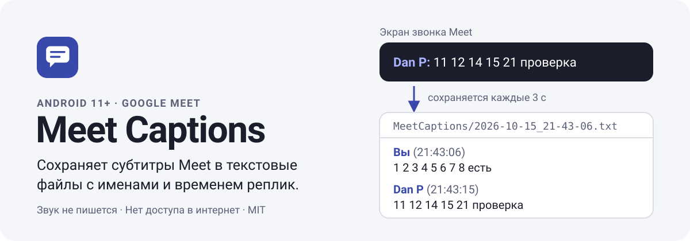
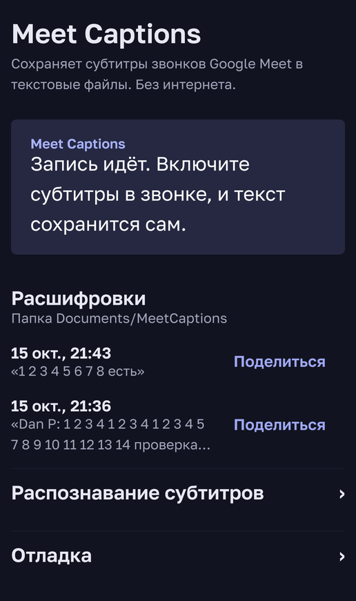

<a href="README.md">English</a> | <b>Русский</b>

Автосохранение субтитров Google Meet на Android: каждый созвон становится текстовым файлом с именами
говорящих и временем реплик. Работает, когда вы не организатор, и на любом языке субтитров, в том числе на русском,
то есть там, где заметки Gemini и транскрипты Meet недоступны.

Служба специальных возможностей читает субтитры с экрана звонка (приложение Meet или звонок Meet в Gmail)
и пишет их в `Documents/MeetCaptions/<дата_время>.txt`. Звук не записывается. Разрешения на интернет у приложения
нет, сторонних библиотек тоже.

Приложение с двумя сохранёнными тестовыми звонками. Язык интерфейса берётся из настроек телефона: русский или английский. Транскрипт выше — из настоящего тестового звонка; «Вы» — так Meet подписывает ваши реплики.

Проверено на Samsung S24 Ultra, Android 16, Meet 379 (октябрь 2026).

## Установка

1. Скачайте `meet-captions-X.Y.Z.apk` из [последнего релиза](https://github.com/octrow/meet-captions-android/releases/latest) и откройте его на телефоне.
   Для автообновлений добавьте адрес этого репозитория в [Obtainium](https://github.com/ImranR98/Obtainium).
2. Если установку остановит Play Защита или Samsung Auto Blocker, см. [«Не устанавливается»](docs/troubleshooting.ru.md#не-устанавливается).
3. Для разработчиков: `adb install -r meet-captions-X.Y.Z.apk` или соберите сами, см.
   [docs/development.ru.md](docs/development.ru.md).

Приложения, установленные из файла, Android помечает «ограниченными»: переключатель службы будет неактивен, пока
вы не разрешите ограниченные настройки. Приложение подскажет, как; подробнее в
[«Служба не включается»](docs/troubleshooting.ru.md#служба-не-включается).

## Включение

1. Настройки → Специальные возможности → Установленные приложения → **Meet Captions** → вкл.
2. Настройки → Приложения → Meet Captions → Батарея → **Без ограничений**, иначе Samsung усыпит службу.
3. В звонке Meet: ⋮ → **Субтитры**, язык встречи. Meet запоминает выбор.

Дальше всё автоматически: пока на экране звонка идут субтитры, файл перезаписывается каждые 3 секунды.
Новый файл начинается, если субтитров не было 5 минут.

## Важно знать

- Записывается только то, что Meet показал субтитрами на **вашем** экране: экран звонка должен быть открыт,
  субтитры включены. В свёрнутом звонке субтитров нет, значит, и записи нет.
- Субтитры — это распознавание речи Google: ошибки распознавания попадут в файл как есть.
- Другие участники не видят, что вы сохраняете субтитры. Проверьте, допускает ли это ваша ситуация
  и законы вашей страны.

## Чем отличается от других вариантов

| Вариант | Отличие |
|---|---|
| Gemini «Делать заметки» и транскрипты Meet | Зависят от тарифа Workspace у организатора; русского нет среди поддерживаемых языков; заметки — пересказ, а не дословный текст. |
| [TranscripTonic](https://github.com/vivek-nexus/transcriptonic) | Расширение Chrome, делает то же на компьютере; на Ubuntu пользуйтесь им. Веб-Meet на телефоне перекидывает в приложение. |
| Боты-участники (Vexa и подобные) | Заходят видимым участником, организатор должен их впустить; нужен сервер. |
| Запись звука и своё распознавание | Нужно согласие на запись, спорит со звонком за микрофон. Субтитры Meet уже распознанный текст. |

Подробнее в [docs/decisions.ru.md](docs/decisions.ru.md).

## Транскрипты на компьютер (Syncthing)

1. Ubuntu: `sudo apt install syncthing && systemctl --user enable --now syncthing`, веб-панель http://127.0.0.1:8384.
2. Телефон: Syncthing-Fork (F-Droid или Google Play), добавить устройство Ubuntu по QR или ID.
3. На телефоне общая папка `Documents/MeetCaptions`, тип «Только отправка». На Ubuntu принять её,
   например, в `~/Downloads/TranscripTonic/android`, рядом с транскриптами TranscripTonic.

## Документация

| Документ | О чём |
|---|---|
| [docs/decisions.ru.md](docs/decisions.ru.md) | Почему именно так: какие варианты рассматривали и отвергли |
| [docs/architecture.ru.md](docs/architecture.ru.md) | Как устроено приложение и как склеиваются субтитры |
| [docs/troubleshooting.ru.md](docs/troubleshooting.ru.md) | Служба не включается, файла нет, вместо имён `?`, Meet обновился |
| [docs/development.ru.md](docs/development.ru.md) | Сборка, тесты, сквозной тест на эмуляторе, работа с телефоном по adb |

[Как помочь](CONTRIBUTING.ru.md) · [Безопасность](SECURITY.ru.md) · [Изменения](CHANGELOG.md) · [Лицензия MIT](LICENSE)
· Шрифт: [Golos Text](third_party/golos-text-OFL.txt), SIL OFL 1.1
