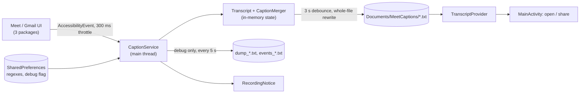

# System design review: meet-captions-android

Kind: on-device Android app (AccessibilityService), no server, network, DB, LLM or account. Steps 3 and the cache part of 5 are n/a.
Flow, modules and known gaps: see [logic-map.md](logic-map.md). Not repeated here.

## Assumptions

| Item | Value | Label |
|---|---|---|
| Users | 1 (the owner), one phone | assumed |
| Calls | 1 h/day of Meet with captions on | assumed |
| Code size | 856 lines Kotlin, 9 files | measured (`wc -l` app/src/main/java/.../*.kt) |
| Repo history | 27 commits, 24 on 2026-10-15, 2 on 10-23, 1 on 11-05 | measured (git log) |
| Event rate | at most 1 event per type per 300 ms (`notificationTimeout`), 3 packages | measured (logic-map step 1); event types in play: assumed 3 |
| Save debounce | 3 s, SESSION_GAP 5 min, debug dump 5 s, events log cap 5 MB | measured (CaptionService.kt:94,96; DebugRecorder.kt:66,67) |
| Transcript size | ~60 KB per 1 h call (about 9k words) | assumed |
| Debug dump size | 50-200 KB per dump | assumed, not measured (no device logs locally) |

## 0. What exists

Single process, main thread: `CaptionService.onAccessibilityEvent` -> merge in memory -> `Handler.postDelayed` save of a whole `.txt` into `Documents/MeetCaptions`. `MainActivity` and `TranscriptProvider` are read-side only. No cron, queue, deploy infra (APK sideload). Rung today: 0, a single device, below rung 1 of the scale ladder (`references/scale-ladder.md`); there is nothing to scale out to.

## 1. Requirements

Task: turn Meet captions on the screen into a speaker-labelled text file, offline, for one user.

- Functional: (1) read caption nodes, (2) merge revisions into turns, (3) write a session file, (4) show a recording notice, (5) share/open files. Out of scope: audio, cloud sync, call-end detection, multi-device.
- NFR (all assumed): latency is not user-facing (file only needs to be current within seconds); availability = service alive during the call, Android may kill it; durability = losing the last <=3 s is OK, losing a whole call is not; privacy = text stays on device (except debug dumps, see risks); battery and main-thread jank matter more than throughput; no observability beyond logcat tag `MeetCaptions`.

## 2. Napkin math

Model the user as 1 DAU, one "request" = one accessibility event processed. Worst case while a call is open: 3 events/s (3 types x 1 per 300 ms is the cap, so this is an upper bound, 10.8k/day at 1 h).

```
$ napkin.py --dau 1 --req-per-user 10800 --peak 3 --write-kb 60 --object-kb 60 --retention-years 1 --read-share 0.1
requests/day 10.8k | average 0.1 req/s | peak (x3) 0.4 req/s
writes at peak 0.3 req/s | shards 1 | replicas 0
verdict: rungs 1-2: one good VPS. Ship it.
(storage lines ignore this app: the script assumes x3 replication and a write per event)
```

```
$ napkin.py --dau 1 --req-per-user 720 --peak 1 --write-kb 60 --retention-years 1 --read-share 0
requests/day 720 | average 0.0 req/s | ingress 4.0 kbit/s
```

Second run = the save path: at most 1 whole-file rewrite per 3 s = 1200/h = 720 per 36 min of active talk. Reading the script output with the app's real shape:

- Load: 0.1-3 events/s on one core, each event walks the node tree of up to 3 windows. Trivial for CPU; the cost is tree traversal on the main thread (assumed, not profiled).
- Disk: transcript is 60 KB per hour of final data, but rewriting it whole every 3 s writes up to 1200 x ~30 KB average (file grows linearly) = ~36 MB/h flash writes (derived: 1200 saves x avg half of 60 KB). Fine for flash, 600x the final size.
- Storage: 60 KB/day -> ~22 MB/year of transcripts. The script's 47-639 GB/year comes from its x3 replication and per-event write, not applicable here.
- Debug mode only (fixed 2026-11-05, now one overwritten dump file): was 720 dump files/h x 50-200 KB = 36-144 MB/h with no cap (assumed sizes). The only number in this app that can really fill a phone. See logic-map #10.

## 3. API contract

n/a as a network service. The only external contract is `TranscriptProvider` (read-only content provider, names matching the session pattern; logic-map "Transcript provider") and the on-disk format (logic-map "Output").

## 4. High-level architecture

Rung 0, one process. Every box below exists in the code.



Why each box: the service is mandatory (Accessibility is the only way to read Meet captions); the in-memory merge exists because each snapshot is the whole visible text (logic-map step 8); the 3 s debounce caps writes at 0.33/s; the file is the only durable store because the requirement is a plain text artifact; the provider exists so other apps can open files without storage permission.

## 5. Deep dive: the data

Engine: a plain file per session; right for the access pattern (append-only logical data, one writer, read after the call). No DB, no cache. Key: file name = timestamp of the first snapshot. Index: none needed; the main screen lists the last 5 by name sort.

Weak points of the format:
- Fixed 2026-11-05: whole-file rewrite is now temp file + rename (`FileIo.kt`), a kill mid-write keeps the previous copy.
- All live state (current block, speaker, turns) is in memory only. Process death mid-call loses up to 3 s of text, and the next event opens a new file (logic-map step 6), so one call can become 2 files.

## 6. Scale and failure

x10 (30 events/s, 10 h calls): nothing saturates in the app's own math. What breaks first is not load but the platform: Android may kill or throttle the service (battery optimisation) and the main thread does tree walking per event. Debug mode at x10 duration: 360-1440 MB/h of dumps.

Failure table:

| Event | Behaviour |
|---|---|
| Meet changes view ids | no blocks found, no file, no notice, no error; fixed by editing regexes in the main screen (logic-map "Variants") |
| Service killed by OS | in-memory state gone, up to 3 s lost, new file on next event |
| Disk full / write error | logged, notice not updated (logic-map #5 fixed) |
| Notification permission denied | no signal at all that recording works |
| Phone restarts | service must be re-enabled by system if it was on; nothing queued |
| Slow third party | n/a, no network |

Retries / backoff / circuit breakers: none and none needed. Backups: none; files live in `Documents`, so Android backup or manual copy is the only copy.

## 7. Trade-offs

- Whole-file rewrite vs append: simple and always consistent text (merge can revise earlier words), costs ~600x write amplification and a non-atomic write window.
- 3 s debounce vs durability: bounds I/O, loses up to 3 s on kill (`onDestroy` now cancels the pending write, logic-map #9 fixed).
- In-memory state vs persisted state: no DB, no crash recovery, one call may split into two files.
- Debug dump on the same folder as transcripts: easy to retrieve, one overwritten dump file per recorder (logic-map #10 fixed), still holds third-party text (#11).
- Accessibility reading vs audio/ASR: no network, no cost, but fully dependent on Meet's UI ids.

## 8. Summary

Design in three lines: one on-device service reading accessibility events; merge in memory; debounced whole-file write into Documents. Correct for 1 user at 3 events/s and ~60 KB/h; no rung above 0 is justified.

Assumptions that would change it: if sessions become many hours or the phone runs other heavy apps (profile main-thread time per event); if Meet's captions stop exposing view ids (the whole approach, not the scale, breaks); if debug mode is left on (disk).

Next rung and trigger: move file writes to a background thread with temp-file + rename when any ANR/jank is seen in logcat during a call or a transcript is found truncated; add an append-only journal when a mid-call kill is lost more than once.

## Risks

- ✅ HIGH (dump count fixed 2026-11-05): debug mode wrote a new dump per 5 s with no cap, 36-144 MB/h assumed; now one overwritten dump file per recorder. Gmail contents are still dumped when Gmail is open (#11). `DebugRecorder.kt:66` (DUMP_INTERVAL_MS), logic-map #10, #11.
- ✅ MEDIUM (fixed): whole-file rewrite was not atomic, a kill mid-write can truncate the only copy of the transcript. `CaptionService.kt:68` (`save()`), verify in `Transcript.kt`.
- MEDIUM: save and tree walk run on the main-thread handler (`CaptionService.kt:47`), per-event traversal cost unmeasured; jank or ANR risk on long calls.
- MEDIUM (partly fixed 2026-11-05): a failed write no longer refreshes the recording notice, but there is still no explicit error signal, so a full disk can still lose a call almost silently (logic-map #5). `CaptionService.kt:68`.
- MEDIUM: all state in memory, process death splits one call into two files and loses <=3 s (`CaptionService.kt:42`, `:96`).
- LOW: ~36 MB/h flash write amplification (derived) from 3 s rewrite of a growing file, `CaptionService.kt:94`.
- LOW: no observability beyond logcat; a Meet UI change fails silently (no blocks, no file). `CaptionService.kt` step 4 in logic-map.
